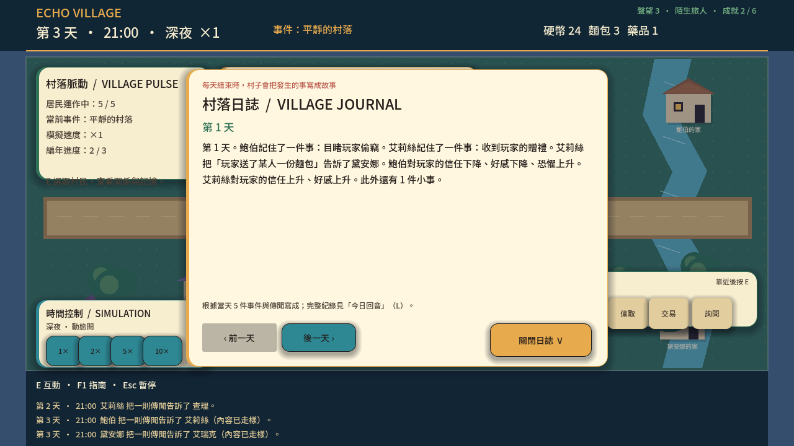
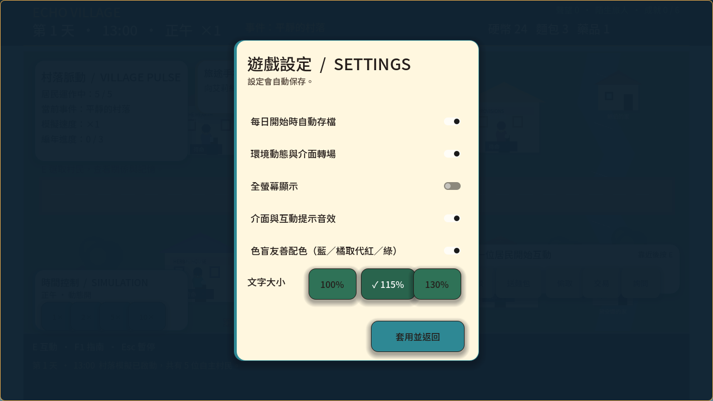

# Echo Village

**一個會傳八卦的村落。** 玩家的每個舉動都會變成居民的記憶，再透過閒聊變成傳聞，在村子裡越傳越走樣；居民會依聽到的版本改變對你的態度、開口提起這件事，甚至自發地請你幫忙澄清。每天結束時，村子會把當天的事寫成一段日誌。

Godot 4.5.2 製作，支援 Windows 桌面版與**瀏覽器即點即玩的網頁版**。所有「AI」都是本地規則與固定種子：不需要 API 金鑰、可離線、同一個世界每次都會演出同樣的故事。

▶ **線上試玩：** https://lily09-project.github.io/EchoVillage/ （合併後由 GitHub Pages 部署）

## 介面預覽

| 傳聞網路：誰聽了哪個版本、從誰那裡聽來 | 村民自發的委託 |
| --- | --- |
|  |  |
| **村落日誌：每天自動寫成的故事** | **無障礙：色盲配色與字級** |
|  |  |
| **NPC 決策依據** | **關係與因果歷程** |
|  |  |

## 創新系統

| 系統 | 做了什麼 | 怎麼驗證 |
| --- | --- | --- |
| **傳聞傳播網路** | 重要記憶變成傳聞，只在信任 ≥ 10 的關係間轉述；每次轉述強度 ×0.72、可信度 ×0.88，30% 機率升級成更誇張的版本。每一次轉述都被記錄，可從任何聽者回溯到原始目擊者 | 同種子結果完全相同、低信任不傳播、強度遞減且必定停止、傳播鏈可回溯、走樣降低可信度 |
| **湧現式委託** | 依居民飢餓、彼此爭執與走樣的流言產生委託；完成後真的改變關係、聲望與需求，澄清後的流言不再傳播 | 引用的居民／物品都存在、同狀態同結果、不可完成或重複的委託不會出現、完成效果符合定義 |
| **記憶驅動對話** | 文法樹依情緒、記憶、聽來的傳聞與需求組句，同一個居民在不同情境說不同的話 | 沒有未填變數、只引用真的記得或聽過的事、同種子可重現、長度 ≤ 90 字 |
| **村落日誌** | 每天結束時根據因果事件與傳聞寫成一段故事，可翻閱過去 30 天 | 只引用當天事件、沒有事件時顯示空狀態 |
| **網頁版** | 單執行緒 Web 匯出 + 內嵌中文字型子集，GitHub Pages 直接可玩 | CI 用 Playwright 在 Chromium 啟動，確認引擎載入且畫面有內容 |
| **無障礙** | 色盲友善配色（藍／橘）、100／115／130% 字級、減少動態；設定會保存 | 偏好只接受合法值、重新載入後仍有效、字級不會累乘 |

既有系統：Utility AI + state machine、需求／性格／排程、關係與記憶、探索與任務、製作與交易、Living Stories 分支、因果歷程、存檔遷移與壞檔復原。架構見 [docs/architecture.md](docs/architecture.md)。

## 操作

```text
WASD 移動   E 選取居民   C 交談   G 贈送   T 交易   Q 詢問
U 傳聞網路  K 任務與委託  V 村落日誌  J 編年  L 今日回音  Y 關係
O 故事線    P 村落手札    M 地圖     F1 導覽  F5 儲存     Esc 暫停
```

## 執行與測試

需求：Godot 4.5.2 stable（Windows 啟動器會從 `GODOT_EXECUTABLE`、PATH 或 `tools/godot` 尋找）。

```powershell
.\run_echo_village.bat --test                                              # 131 項自動測試
powershell -NoProfile -ExecutionPolicy Bypass -File quality\run_acceptance.ps1 release
.\build_release.bat                                                        # Windows portable
```

網頁版（任何平台）：

```bash
python tools/fetch_web_template.py          # 只下載約 10 MB 的 Web 模板（以 HTTP range 從官方 1.3 GB 套件取出並驗證 SHA-256）
godot --headless --path . --export-release "Web" release/web/index.html
cd tools/web_smoke && npm ci && npx playwright install chromium && npm run smoke
```

| 驗收 | 指令／CI | 結果 |
| --- | --- | --- |
| 自動測試 | `run_echo_village.bat --test`（CI：Echo Village CI） | 131 passed / 0 failed，無 SCRIPT ERROR、無物件洩漏 |
| 視覺 QA | `tools/run_visual_qa_matrix.ps1` | 19 個畫面 × 4 種解析度 |
| 網頁版 | `.github/workflows/web.yml` | Chromium 冒煙測試通過；匯出大小寫在 job summary |
| 長時間穩定 | `.github/workflows/nightly-soak.yml` | 模擬 90 天，傳聞、記憶、日誌都在上限內 |
| 安全 | `tools/security_audit.ps1`、gitleaks | 0 筆發現 |

驗收標準在重做前就訂在 [docs/ACCEPTANCE.md](docs/ACCEPTANCE.md)。

## 範圍與安全

不提交 Godot engine、`.godot` cache、release 產物或使用者存檔。安全規則見 [SECURITY.md](SECURITY.md)，遊戲設計見 [docs/game_design.md](docs/game_design.md)。字型為 Noto Sans TC（SIL Open Font License，見 `assets/fonts/OFL.txt`）。

目前版本：Echo Village 2.0.0｜Godot 4.5.2｜Windows 10/11 64-bit、Chromium／Firefox／Safari
