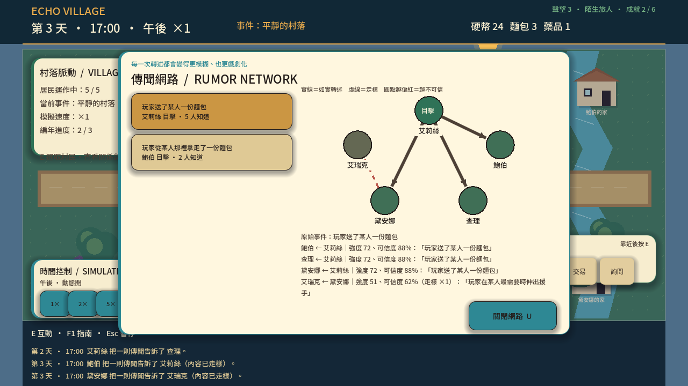
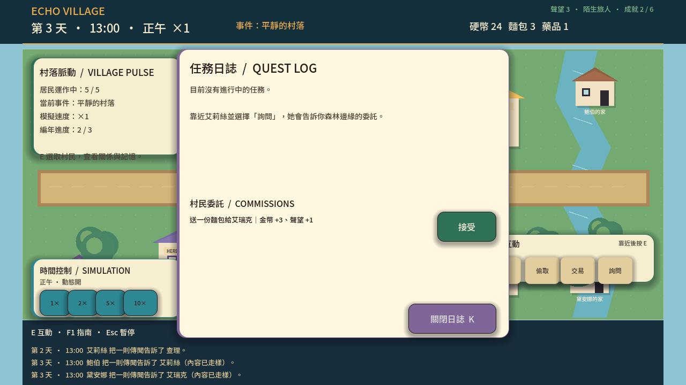
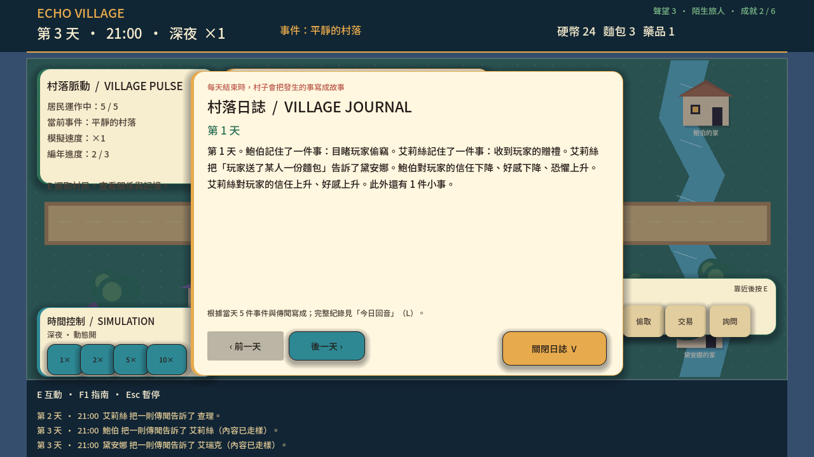
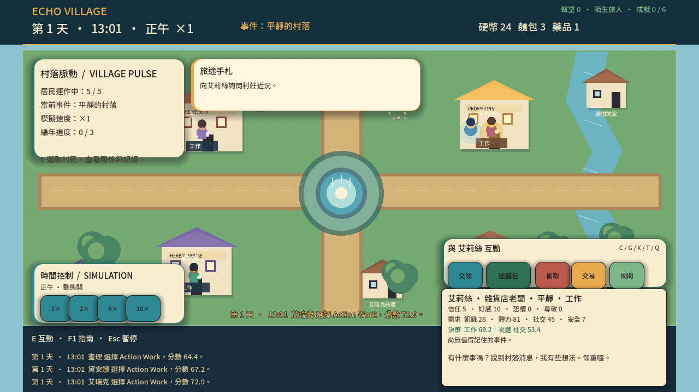
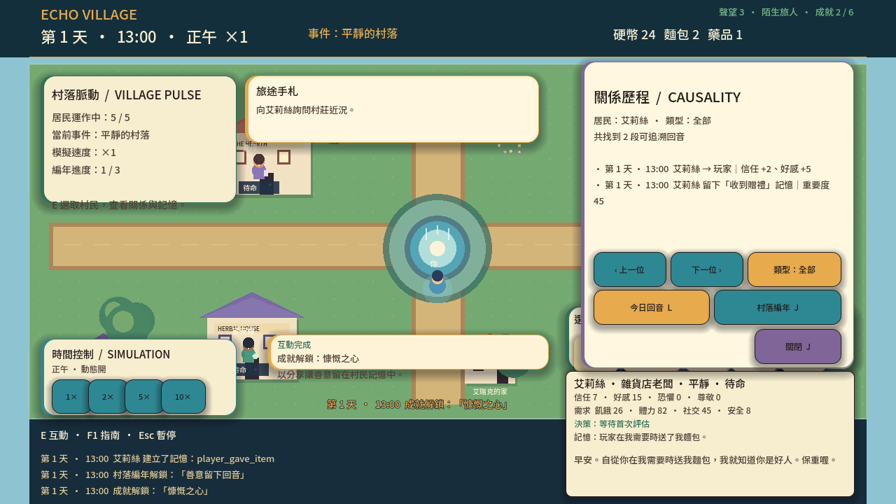

# Echo Village

[](https://github.com/Lily09-project/EchoVillage/actions/workflows/ci.yml)
[](https://github.com/Lily09-project/EchoVillage/actions/workflows/web.yml)

**會記得你的村落。** 你做的每件事都會被某位居民記住，再被轉述成越傳越走樣的傳聞，改變村民之間的關係，最後變成他們主動找你幫忙的委託。全部由本地規則驅動，可離線遊玩，不需要 API 金鑰。

### ▶ [在瀏覽器直接試玩](https://lily09-project.github.io/EchoVillage/)　｜　[下載 Windows 版 v1.4.0](https://github.com/Lily09-project/EchoVillage/releases/tag/v1.4.0)

> 網頁版首次載入約 10 MB（壓縮後），請使用桌機的 Chrome、Edge 或 Firefox，並以鍵盤遊玩；手機可以開啟，但無法移動角色。



## 有什麼特別

- **傳聞會走樣**：重要的事會在互相信任的居民之間轉述，每傳一次強度與可信度都會下降，還可能被加油添醋。按 `U` 可以看到完整的傳播鏈，並一路追回原始目擊者。
- **委託從模擬裡長出來**：居民挨餓、彼此爭執或流言失控時，會自己提出委託；完成後真的會改變需求、關係與聲望，被澄清的流言也會停止傳播。
- **對話只說他們知道的事**：居民的台詞由文法組句，只引用自己記得或聽說過的事件。
- **每天寫成一篇日誌**：一天結束時，村子會把當天發生的事寫成短文，每句都能對應到實際事件。
- **決策看得見**：選取居民就能看到這次行動的最高分、次選與原因；`F3` 顯示完整的 Utility 分數。

## 30 秒上手

1. 在主選單按 `Enter`（或點「開始新旅程」），跟著五步驟導覽走一遍。
2. 用 `WASD` 或方向鍵走到居民旁，按 `E` 選取，再按 `G` 送麵包或 `X` 偷麵包。
3. 按 `2`／`5`／`0` 加快時間，讓村子過一陣子後按 `U` 看你的事蹟怎麼被傳開、按 `K` 接下村民的委託。

| 按鍵 | 功能 | 按鍵 | 功能 |
| --- | --- | --- | --- |
| `WASD`／方向鍵 | 移動 | `E` | 選取附近居民 |
| `C`／`Q` | 交談／詢問 | `G`／`T`／`X` | 送麵包／交易／偷取 |
| `U` | 傳聞網路 | `K` | 任務與委託 |
| `V` | 村落日誌 | `L`／`J`／`Y` | 今日回音／村落編年／關係歷程 |
| `1` `2` `5` `0` | 時間 1×／2×／5×／10× | `F1`／`Esc` | 導覽／暫停 |

## 畫面

| 村民委託 | 村落日誌 |
| --- | --- |
|  |  |
| **居民的決策依據** | **關係歷程** |
|  |  |

## 主要系統

- NPC 需求、性格、排程與 Utility AI 自主決策
- 有來源脈絡的記憶、傳聞與關係變化
- 可完成的任務、交易、製作與故事分支
- 可追溯的村落日誌、存檔遷移與備份復原
- 色盲友善配色、文字縮放與可調整動態效果

## 發行狀態

Windows 最新正式版本為 [Echo Village v1.4.0](https://github.com/Lily09-project/EchoVillage/releases/tag/v1.4.0)。網頁版會隨主分支自動部署，包含 v1.4.0 之後尚未正式發布的 2.0 功能（傳聞、委託、日誌）；未正式發布的建置不代表穩定 Windows 版。

## 本機執行與驗證

需求：Godot 4.5.2 stable。

```powershell
.\run_echo_village.bat --test
powershell -NoProfile -ExecutionPolicy Bypass -File quality\run_acceptance.ps1 release
```

網頁版建置與驗收方式見 [架構](docs/architecture.md)、[驗收標準](docs/ACCEPTANCE.md)及[安全政策](SECURITY.md)。正式版下載與 SHA-256 驗證方式請查看 [GitHub Releases](https://github.com/Lily09-project/EchoVillage/releases)。
