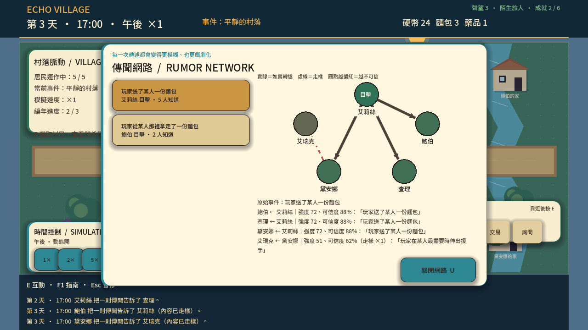
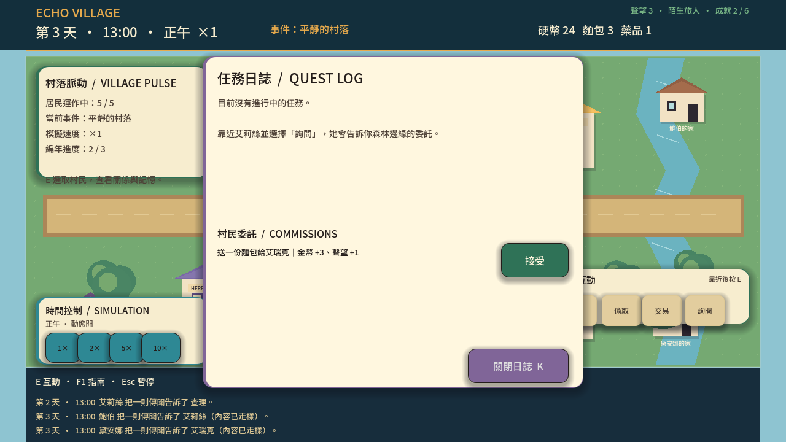

# Echo Village

[](https://github.com/Lily09-project/EchoVillage/actions/workflows/ci.yml)
[](https://github.com/Lily09-project/EchoVillage/actions/workflows/web.yml)

一款由本地規則驅動的村落生活模擬遊戲：居民會記住事件、轉述傳聞、改變關係，並自發產生新的委託。可離線遊玩，不需要 API 金鑰。

**[瀏覽器試玩](https://lily09-project.github.io/EchoVillage/)**

## 畫面

| 傳聞網路 | 村民委託 |
| --- | --- |
|  |  |

## 主要系統

- NPC 需求、性格、排程與自主決策
- 有來源脈絡的記憶、傳聞與關係變化
- 可完成的任務、交易、製作與故事分支
- 可追溯的村落日誌、存檔遷移與備份復原
- 色盲友善配色、文字縮放與可調整動態效果

## 發行狀態

Windows 最新正式版本為 [Echo Village v1.4.0](https://github.com/Lily09-project/EchoVillage/releases/tag/v1.4.0)。目前主分支持續開發後續版本；未正式發布的建置不代表穩定 Windows 版。

## 本機執行與驗證

需求：Godot 4.5.2 stable。

```powershell
.\run_echo_village.bat --test
powershell -NoProfile -ExecutionPolicy Bypass -File quality\run_acceptance.ps1 release
```

網頁版建置與驗收方式見 [架構](docs/architecture.md)、[驗收標準](docs/ACCEPTANCE.md)及[安全政策](SECURITY.md)。正式版下載與 SHA-256 驗證方式請查看 [GitHub Releases](https://github.com/Lily09-project/EchoVillage/releases)。
